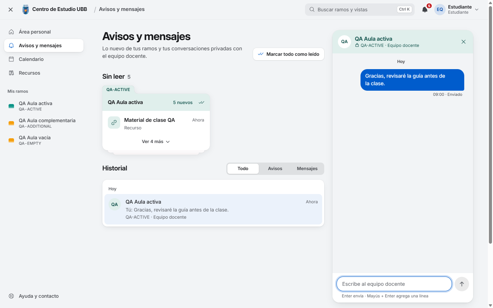
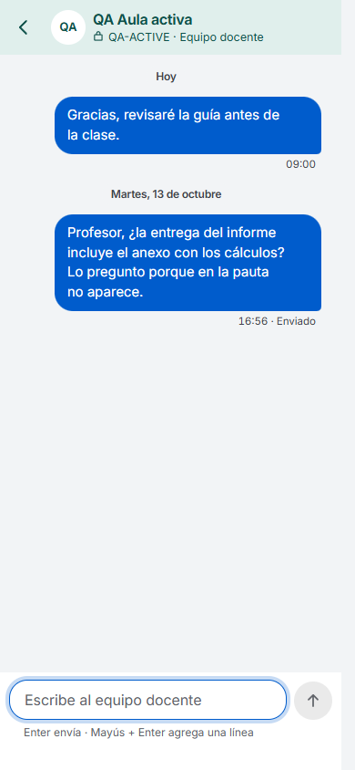
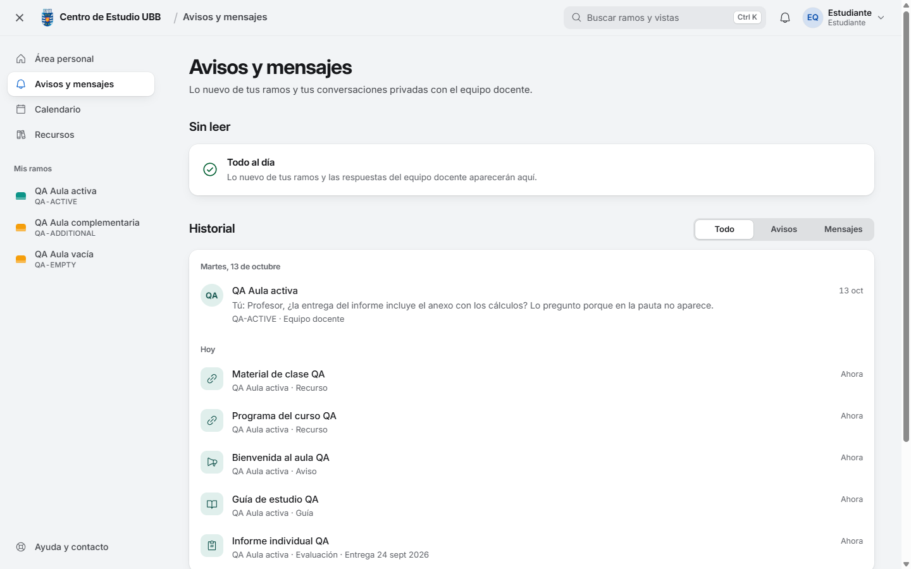

# Avisos y mensajes redesign

Structure chosen by the owner on the Impeccable decision page: "Lo pendiente primero". The screen opens on what awaits the user, summarized as one stacked sheet per section; read items move to a single history; a conversation docks as a column beside the page on desktop and takes the full screen on phones. The header bell follows the same order (unread first, then earlier items) as a popover on desktop and a draggable `vaul` sheet on phones.

## What changed

- **Unread band.** One stack per section, carrying the section divider tab and a `--tone-wash` head with the count and a mark-as-read action. Narrower sheets peek under the front sheet when more items wait; the stack fans out in place (grid rows transition) and leaves with a spring when marked read. With nothing pending the band shows "Todo al día".
- **History.** One sheet grouped by day with sticky day labels. Todo and Avisos list only read items, so nothing repeats the band; Mensajes is the full conversation directory with search, unread dots in a leading column and "Por responder" for teachers when the student wrote last.
- **Conversation.** Docked column (clamp 340 to 440px) with a section-tone header, white incoming bubbles on the desk, UBB-blue own bubbles, turns grouped by author and a ten-minute gap, day separators, a "Mensajes nuevos" marker from the cursor captured at open, optimistic sending with "Enviando…" and "Enviado", Enter to send on fine pointers, per-conversation drafts, and a jump-to-latest control. On phones it is a full-screen layer that slides in from the right, hides the header and bottom navigation, honours safe areas and answers the Android back button.
- **Time.** `stampLabel` and `dayLabel` in `lib/communications.ts` give one voice to every timestamp ("Ahora", "Hace 5 min", clock time, "Ayer", weekday, short date), refreshed by the shared `useClock` hook.
- **Read state.** Opening a conversation, or receiving a message while it is open, marks the thread read. No data model, rule or function changed; read receipts were left out because they would expose teachers' reading activity and need thread-level markers.

## Verification

- `pnpm test` (production build, unit and rendered HTML suites), `verify:fast` (657 tests, 75 sealed test files, 32 OpenSpec specs), `verify:invariants`, lint (two pre-existing warnings in other views), TypeScript and Prettier.
- New unit tests in `tests/communications-thread.test.ts` cover time labels, day labels, turn grouping, the unread marker and the awaiting-reply state.
- Agent QA against local emulators: communications scenarios at 320, 390, 768 and 1440 in Chromium; `communications.reply` and `communications.messages` in Firefox and WebKit; `shell.notifications` and `shell.notifications-loading`. `api.performance.isolation` fails in development mode by design (it needs `--production`). `shell.palette`, `shell.palette-empty` and `shell.motion` fail at 320px on `main` as well (palette overlay leaves the bottom navigation 0.4px exposed); tracked separately.
- Independent finish review: five material fixes and one regression found and resolved in two verdict passes.

## Captures

Playwright captures of the real application with synthetic QA identities and data. The QA browser clock is fixed in the past, so a message sent on the day of capture appears under its calendar date after a "Hoy" group.

